# GAMDIAS CHIONE P3 Cooler Display for Linux (Ubuntu)

Native Linux driver, telemetry monitor, and customization tool for the **GAMDIAS CHIONE P3** AIO Liquid CPU Cooler (`CHIONE P3-240U` & `CHIONE P3-360U`).

---

## Features
- **Real-Time Telemetry:** Displays CPU usage & temperature (Intel/AMD) and GPU usage, temperature & VRAM (NVIDIA RTX 4090 / GeForce / etc.).
- **Multiple Visual Themes:**
  - `reactor`: **(Official Animation)** 160-frame pulsing blue/cyan reactor ring with translucent telemetry cards.
  - `vortex`: **(Official Animation)** 64-frame fluid swirl vortex with high-contrast readouts.
  - `hud`: **(Official Animation)** 160-frame spinning circular gauge HUD animation.
  - `ring`: **(Official Background)** GAMDIAS CHIONE P3 golden tech ring background (`preset_0.png`).
  - `neon`: **(Official Background)** Authentic GAMDIAS single-metric glowing blue-purple neon ring (`cgif1_bg.png`).
  - `neon-flow`: **(Official Animation)** 64-frame cycling neon gradient ring with single-metric readout (`official_anim_1.gif`).
  - `dual`: Dual arc gauges with real-time temperature, load, clock, and RAM info (large % readout).
  - `cyberpunk`: Concentric neon rings for CPU and GPU with high-contrast readouts.
  - `bignum`: Dominant large single-number readout (CPU or GPU %) with a 270° tachometer arc gauge.
  - `simple`: Minimalist clean card dashboard.
  - Custom `--bg <image_or_gif>`: Overlay live telemetry cards onto ANY user-provided GIF animation or image!
- **Official Assets & Animations:** Shipped with all vendor animations (`official_anim_1.gif`, `official_anim_2.gif`, `cgif.gif`) and backgrounds.
- **Custom Images & Animations:** Stream static images (`.png`, `.jpg`) or animated GIFs directly to the 240×240 IPS LCD screen.
- **Orientation & Brightness Control:** Configure rotation (`0°`, `90°`, `180°`, `270°`) and brightness (`1` to `8`).
- **Ubuntu/Debian Packaging:** Built-in `.deb` package generation and `Makefile` for one-command distribution.
- **No Root Required:** Simple udev rule enables regular users in the `plugdev` group to control the display.
- **Systemd Background Service:** Can run seamlessly on boot in the background.

---

## Visual Theme Gallery

| Preview | Theme | Type | Description | CLI Command |
| :---: | :---: | :---: | :--- | :--- |
| 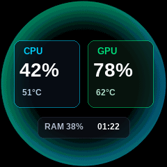 | `reactor` | Official Animated | 160-frame pulsing cyan-blue reactor ring with dual frosted telemetry cards | `chionecast --theme reactor` |
|  | `vortex` | Official Animated | Fluid energy vortex swirl animation with high-contrast CPU & GPU readouts | `chionecast --theme vortex` |
| 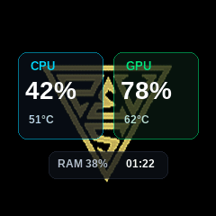 | `hud` | Official Animated | Spinning circular gauge HUD animation with dual telemetry overlay | `chionecast --theme hud` |
| 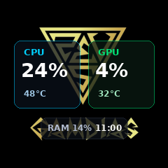 | `ring` | Official Static | Authentic GAMDIAS CHIONE P3 golden tech ring backdrop (`preset_0.png`) | `chionecast --theme ring` |
| 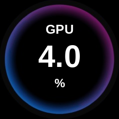 | `neon` | Official Static | Exact replica of the official GAMDIAS single-metric blue-purple neon ring (`cgif1_bg.png`) | `chionecast --theme neon --primary gpu` |
| 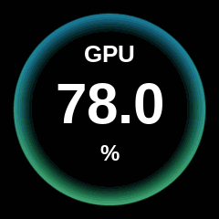 | `neon-flow` | Official Animated | 64-frame smoothly cycling neon gradient ring with single-metric readout (`official_anim_1.gif`) | `chionecast --theme neon-flow --primary gpu` |
| 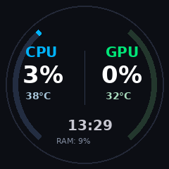 | `dual` | Procedural Vector | Dual electric tachometer sweep arcs for CPU & GPU with clock and RAM | `chionecast --theme dual` |
| 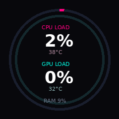 | `cyberpunk` | Procedural Vector | Concentric neon magenta and cyan progress rings with stacked readouts | `chionecast --theme cyberpunk` |
| 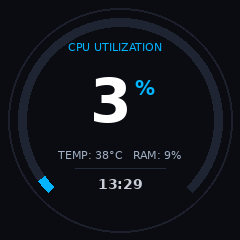 | `bignum` | Procedural Vector | Dominant massive 60px central percentage with a 270° color-adapting tachometer arc | `chionecast --theme bignum` |
| 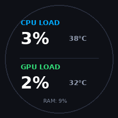 | `simple` | Procedural Vector | Clean minimalist two-card dashboard with subtle circular border | `chionecast --theme simple` |

---

## Official Vendor GIF & Background Assets

All original GAMDIAS AEOLUS Box animations and background assets are included in `assets/official/` and can be used directly via built-in themes or passed to `--bg` / `--gif` / `--image`:

### Official Animated GIFs (`assets/official/animations/`)

| Preview | Asset Path | Frames | Used By Theme / Description |
| :---: | :--- | :---: | :--- |
| 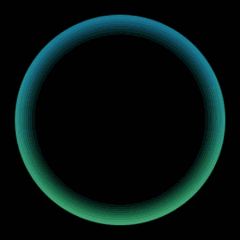 | `assets/official/animations/official_anim_1.gif` | 64 | `neon-flow` — Flowing neon gradient ring animation |
| 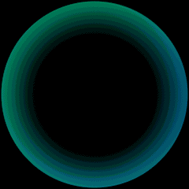 | `assets/official/animations/official_anim_2.gif` | 160 | `reactor` — Pulsing cyan/emerald reactor ring animation |
|  | `assets/official/animations/cgif.gif` | 160 | `vortex` / `hud` — Circular HUD & vortex animation |

### Official Static Backgrounds (`assets/official/backgrounds/`)

| Preview | Asset Path | Description |
| :---: | :--- | :--- |
| 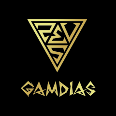 | `assets/official/backgrounds/preset_0.png` | `ring` — Golden GAMDIAS tech ring |
|  | `assets/official/backgrounds/preset_1.png` | Minimalist dark circular frame preset |
| 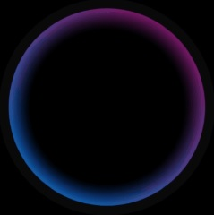 | `assets/official/backgrounds/cgif1_bg.png` | `neon` — Static blue-to-purple neon ring backdrop |
| 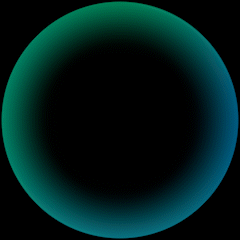 | `assets/official/backgrounds/cgif2_bg.png` | Cyan reactor ring static backdrop |
|  | `assets/official/backgrounds/cgif_bg.png` | Circular gauge HUD static backdrop |
|  | `assets/official/backgrounds/cimg.png` | Default custom image placeholder backdrop |

---

## Installation & Distribution for Ubuntu / Debian

### Option A: Install via Official GitHub Release (.deb)
```bash
# 1. Download the latest .deb package
curl -sLO https://github.com/dhyanesh/chionecast/releases/download/v1.1.0/chionecast_1.1.0_all.deb

# 2. Install the package
sudo apt install -y ./chionecast_1.1.0_all.deb

# 3. Reload udev rules for non-root USB access
sudo udevadm control --reload-rules && sudo udevadm trigger

# 4. (Optional) Enable auto-start on desktop login
systemctl --user enable --now chionecast
```

Once installed, `chionecast` is available system-wide:
```bash
chionecast --rotate 180 --theme neon --primary gpu
```

### Option B: Quick Setup from Source
```bash
# 1. Install Udev Rules
./setup.sh

# 2. Run with official animated Reactor theme (rotated 180°)
./venv/bin/python chione_cli.py --rotate 180 --theme reactor

# Run with official animated Vortex theme
./venv/bin/python chione_cli.py --rotate 180 --theme vortex

# Run with official animated HUD theme
./venv/bin/python chione_cli.py --rotate 180 --theme hud

# Run with official Golden Ring theme
./venv/bin/python chione_cli.py --rotate 180 --theme ring

# Run with default Dual Gauge theme
./venv/bin/python chione_cli.py --rotate 180 --theme dual

# Run with Big Number theme
./venv/bin/python chione_cli.py --rotate 180 --theme bignum

# Overlay telemetry onto any custom animated GIF
./venv/bin/python chione_cli.py --rotate 180 --bg /path/to/my_animation.gif
```

---

### Configuring Displayed Metrics (Theme-Independent)

You can assign any metric to any slot on the display regardless of which theme you use:
- `--primary <cpu|gpu|ram|vram>`: Assigns primary metric (left card, outer ring, or big number)
- `--secondary <cpu|gpu|ram|vram>`: Assigns secondary metric (right card, inner ring)
- `--aux <ram|vram|none>`: Assigns bottom badge metric
- `--unit <C|F>`: Sets temperature unit (°C or °F)

```bash
# Display GPU as primary and CPU as secondary
./venv/bin/python chione_cli.py --primary gpu --secondary cpu

# Monitor CPU and RAM with Fahrenheit temperatures
./venv/bin/python chione_cli.py --primary cpu --secondary ram --unit F
```

### Persistent Configuration & Automatic Bootup

CHIONECAST saves user preferences to `~/.config/chionecast/config.json`. The systemd bootup service reads this configuration automatically on startup without requiring any service file modifications.

```bash
# Save your preferred setup (e.g. 180° rotation, reactor theme, GPU primary)
./venv/bin/python chione_cli.py --rotate 180 --theme reactor --primary gpu --secondary cpu --save-config --config-only

# View current configuration
./venv/bin/python chione_cli.py --show-config
```

---

## Command Reference

### Set Screen Rotation & Brightness
```bash
# Rotate display 90 degrees and set maximum brightness (8)
./venv/bin/python chione_cli.py --rotate 90 --brightness 8
```

### Process Management & Screen Clearing
```bash
# Terminate any existing background session and take over the display
./venv/bin/python chione_cli.py --replace --rotate 180 --theme reactor

# Clear the screen to black and exit
./venv/bin/python chione_cli.py --clear
```

### Display Static Image or Animated GIF
```bash
# Display a custom image (automatically resized to 240x240)
./venv/bin/python chione_cli.py --image /path/to/picture.png

# Play an animated GIF in a continuous loop
./venv/bin/python chione_cli.py --gif /path/to/animation.gif
```

### Adjust Refresh Rate
```bash
# Update every 0.5 seconds
./venv/bin/python chione_cli.py --theme dual --interval 0.5
```

---

## Enable Automatic Startup on Boot (Systemd)

To run the display dashboard automatically whenever you log into Ubuntu:
```bash
mkdir -p ~/.config/systemd/user
cp chione-display.service ~/.config/systemd/user/
systemctl --user daemon-reload
systemctl --user enable --now chione-display.service
```

To check service status:
```bash
systemctl --user status chione-display.service
```

---

## Documentation
- **[Display Themes Gallery & Reference (docs/themes.md)](docs/themes.md):** Full visual catalog of all 10 built-in themes, visual styles, and preview screenshots.
- **[Reverse Engineering & Protocol Specification](REVERSE_ENGINEERING_AND_PROTOCOL.md):** Complete technical breakdown of the USB HID protocol, packet structures, checksum algorithms, and AEOLUS Box reverse engineering findings.
