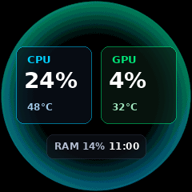
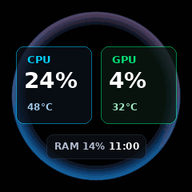
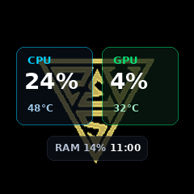
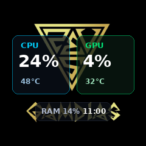
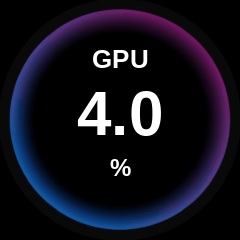
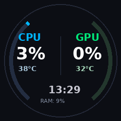
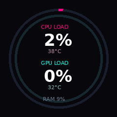
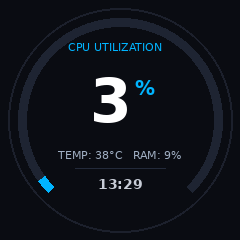
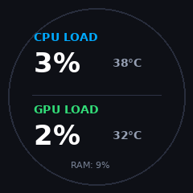

# GAMDIAS CHIONE P3 Display Themes Catalog

This document catalogs all built-in display themes and customization options available in **CHIONECAST** for the GAMDIAS CHIONE P3 AIO cooler's 240×240 IPS LCD screen.

---

## Design Principles
- **Circular Display Optimization:** Visual layouts are bounded and composed specifically for a 240×240 circular viewport (r = 120px) without content clipping.
- **Usage Over Temperature Priority:** System load percentages (CPU %, GPU %) are rendered as the primary, high-contrast, large-font readouts across all themes, while temperatures are styled as secondary context.
- **Frosted HUD Backing:** For animated backdrops, translucent rounded cards (`rgba(10, 16, 26, 0.72)`) ensure crisp legibility over dynamic, brightly colored animation frames.
- **Smooth 25–30 FPS Streaming:** Animated themes run fluidly over USB HID interrupt reports with asynchronous telemetry polling.

---

## Visual Theme Gallery

### 1. Reactor (`--theme reactor`)
* **Type:** Official Animated Theme (160 frames, ~27 FPS)
* **Visual Style:** Pulsing cyan-blue energy reactor ring with dual frosted HUD telemetry cards.
* **Layout:**
  - **Left Card:** Cyan `CPU` title, large bold CPU usage percentage (`28px`), muted CPU temperature (`12px`).
  - **Right Card:** Emerald `GPU` title, large bold GPU usage percentage (`28px`), muted GPU temperature (`12px`).
  - **Bottom Pill:** Real-time RAM utilization percentage and digital clock (`HH:MM`).
* **CLI Command:**
  ```bash
  chionecast --rotate 180 --theme reactor
  ```



---

### 2. Vortex (`--theme vortex`)
* **Type:** Official Animated Theme (64 frames, ~27 FPS)
* **Visual Style:** Dynamic fluid vortex swirl energy animation with high-contrast readouts.
* **Layout:**
  - Center dual frosted telemetry cards for CPU & GPU.
  - Floating bottom pill with RAM and system time.
* **CLI Command:**
  ```bash
  chionecast --rotate 180 --theme vortex
  ```



---

### 3. Futuristic HUD (`--theme hud`)
* **Type:** Official Animated Theme (160 frames, ~27 FPS)
* **Visual Style:** Rotating circular tech HUD ring with telemetry cards overlaid in the core aperture.
* **Layout:**
  - Dual telemetry cards (CPU left, GPU right).
  - High-contrast white usage numbers with colored headers.
* **CLI Command:**
  ```bash
  chionecast --rotate 180 --theme hud
  ```



---

### 4. Golden Tech Ring (`--theme ring`)
* **Type:** Official Static Theme (240×240)
* **Visual Style:** Authentic GAMDIAS CHIONE P3 golden/amber tech ring backdrop (`preset_0.png`).
* **Layout:**
  - Dual frosted cards positioned over the dark center core.
  - High contrast on amber and gold accents.
* **CLI Command:**
  ```bash
  chionecast --rotate 180 --theme ring
  ```



---

### 5. Authentic Neon Ring (`--theme neon`)
* **Type:** Official Vendor Static / Single-Metric Theme (240×240)
* **Visual Style:** Exact replica of the official GAMDIAS Windows software single-metric display (`cgif1_bg.png`). Glowing blue-to-purple neon circular ring around a pitch-black aperture.
* **Layout:**
  - **Top:** Metric label (`GPU` or `CPU`) in bold white uppercase (`26px`).
  - **Center:** Massive bold white percentage formatted with 1 decimal place (`4.0`, `62px`).
  - **Bottom:** Centered `%` symbol in bold white (`24px`).
* **CLI Command:**
  ```bash
  chionecast --rotate 180 --theme neon --primary gpu
  ```



---

### 6. Flowing Neon Ring (`--theme neon-flow`)
* **Type:** Official Vendor Animated Theme (64 frames, ~25 FPS)
* **Visual Style:** The authentic neon ring smoothly cycling its gradient colors (cyan, blue, magenta, purple) around the circumference.
* **Layout:** Same clean, single-metric layout as `neon`.
* **CLI Command:**
  ```bash
  chionecast --rotate 180 --theme neon-flow --primary gpu
  ```

---

### 7. Dual Gauge Tachometer (`--theme dual`)
* **Type:** Native Procedural Vector Theme (Default)
* **Visual Style:** Clean dual tachometer arcs on deep obsidian background.
* **Layout:**
  - **Left Arc:** Electric cyan sweep gauge (130° to 230°) tracking CPU load with large `34px` bold readout.
  - **Right Arc:** Emerald green sweep gauge (-50° to 50°) tracking GPU load with large `34px` bold readout.
  - **Center:** Digital clock (`HH:MM`) and RAM usage.
* **CLI Command:**
  ```bash
  chionecast --rotate 180 --theme dual
  ```



---

### 8. Cyberpunk Concentric Neon (`--theme cyberpunk`)
* **Type:** Native Procedural Vector Theme
* **Visual Style:** Concentric neon rings inspired by futuristic synthwave UI.
* **Layout:**
  - **Outer Ring:** Hot pink / neon magenta (`#FF0080`) ring tracking CPU load.
  - **Inner Ring:** Bright neon cyan (`#00FFE6`) ring tracking GPU load.
  - **Center Top:** Large CPU usage with small temperature readout.
  - **Center Bottom:** Large GPU usage with small temperature readout.
* **CLI Command:**
  ```bash
  chionecast --rotate 180 --theme cyberpunk
  ```



---

### 9. Big Number Sweep (`--theme bignum`)
* **Type:** Native Procedural Vector Theme
* **Visual Style:** Dominant massive central percentage with a 270° tachometer arc gauge.
* **Layout:**
  - **Center:** Giant `60px` primary load percentage with dynamic color adaptation (Cyan → Orange at >75% → Crimson at >90%).
  - **Arc:** 270° sweep tachometer tracking utilization.
  - **Bottom Row:** Compact secondary temperature, RAM percentage, and digital time.
* **CLI Command:**
  ```bash
  chionecast --rotate 180 --theme bignum
  ```



---

### 10. Simple Minimalist (`--theme simple`)
* **Type:** Native Procedural Vector Theme
* **Visual Style:** Clean card interface with subtle perimeter boundary.
* **Layout:**
  - **Top Card:** CPU load in large `34px` font beside small temperature.
  - **Divider:** Subtle horizontal separator.
  - **Bottom Card:** GPU load in large `34px` font beside small temperature.
  - **Footer:** RAM utilization centered at bottom.
* **CLI Command:**
  ```bash
  chionecast --rotate 180 --theme simple
  ```



---

## Custom Background & Animation Overlays (`--bg`)

You can composite live hardware telemetry cards onto **any** custom animated GIF or image:

```bash
# Overlay telemetry onto an animated GIF
chionecast --rotate 180 --bg /path/to/custom_animation.gif

# Overlay telemetry onto a static wallpaper
chionecast --rotate 180 --bg /path/to/custom_wallpaper.png
```

---

## Quick Reference Summary

| Theme Name | Type | Primary Feature | Command |
|---|---|---|---|
| `reactor` | Animated | 160-frame cyan reactor ring | `chionecast --theme reactor` |
| `vortex` | Animated | 64-frame fluid energy swirl | `chionecast --theme vortex` |
| `hud` | Animated | 160-frame spinning circular gauge | `chionecast --theme hud` |
| `ring` | Static | Official golden tech ring | `chionecast --theme ring` |
| `neon` | Static | Authentic blue-purple neon ring (single metric) | `chionecast --theme neon` |
| `neon-flow`| Animated | 64-frame cycling neon gradient ring | `chionecast --theme neon-flow` |
| `dual` | Vector | Dual electric tachometer arcs | `chionecast --theme dual` |
| `cyberpunk`| Vector | Concentric neon magenta/cyan rings | `chionecast --theme cyberpunk` |
| `bignum` | Vector | Massive 60px number + 270° arc | `chionecast --theme bignum` |
| `simple` | Vector | Minimalist two-card dashboard | `chionecast --theme simple` |
| *Custom* | User GIF/PNG | Frosted telemetry over user media | `chionecast --bg <file>` |

---

## Independent Metric Configuration

Telemetry metric selection is completely decoupled from visual themes. Any metric can be assigned to any slot:

| Flag | Supported Values | Default | Visual Mapping |
|---|---|---|---|
| `--primary` | `cpu`, `gpu`, `ram`, `vram` | `cpu` | Left card / Outer neon ring / Big number tachometer |
| `--secondary` | `cpu`, `gpu`, `ram`, `vram`, `none` | `gpu` | Right card / Inner neon ring (or `none` for centered single-metric mode) |
| `--aux` | `ram`, `vram`, `none` | `ram` | Bottom status pill badge |
| `--unit` | `C`, `F` | `C` | Temperature readout unit (°C / °F) |

### Single-Metric Mode (`--secondary none`)
To show only one metric without a secondary card/ring, pass `--secondary none`. Themes dynamically re-layout to display a centered, enlarged single-metric card or arc:

```bash
# Centered single card on animated Reactor theme
chionecast --theme reactor --primary cpu --secondary none

# Centered single 220° sweep tachometer on Dual Gauge theme
chionecast --theme dual --primary gpu --secondary none
```

### Examples:
```bash
# Monitor GPU as primary and CPU as secondary on Reactor theme
chionecast --theme reactor --primary gpu --secondary cpu

# Monitor CPU and System RAM on Dual Gauge theme
chionecast --theme dual --primary cpu --secondary ram

# Monitor GPU load in Big Number theme
chionecast --theme bignum --primary gpu

# Save chosen metrics and theme to persistent configuration (~/.config/chionecast/config.json)
chionecast --theme reactor --primary gpu --secondary none --save-config --config-only
```

